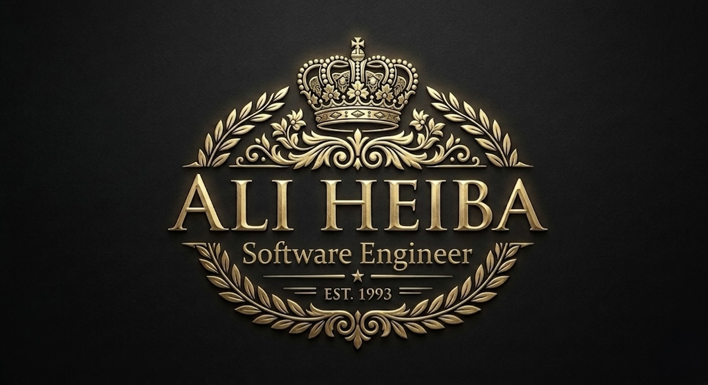

<div align="center">
  
  <h1>Heiba Claude Code 🚀</h1>
  <h3>Developed & Maintained by Eng Ali Heiba</h3>
  <p><strong>The Ultimate Performance Optimization System for AI Agents</strong></p>

  <p>
    
    
    
    
  </p>
</div>

---

## 🌟 Overview

**Heiba Claude Code** is a comprehensive performance optimization system for AI agent harnesses. It is not just a collection of configurations, but a complete ecosystem including skills, instincts, memory optimization, continuous learning, and security scanning.

Enhanced and curated by **Eng Ali Heiba**, this system is designed to work seamlessly across **Claude Code**, **Cursor**, **OpenCode**, and other major AI agent platforms.

## ✨ Key Features

- 🧠 **Memory Optimization:** Advanced hooks that save and load context across sessions automatically.
- ⚡ **Token Slimming:** System prompt optimization and background process management.
- 🛠️ **Continuous Learning:** Auto-extract patterns from sessions into reusable, evolving skills.
- 🔒 **Security Scanning:** Integrated AgentShield for real-time security auditing and sandboxing.
- 🌍 **Multi-Language Support:** Production-ready rules for 12+ language ecosystems including TypeScript, Python, Go, Java, and more.

---

## 🚀 Getting Started

### Installation

```bash
git clone https://github.com/darklegend5/heiba-claude-code.git
cd heiba-claude-code
./install.sh
```

### Usage

Heiba Claude Code provides a suite of commands and agents to supercharge your development workflow. Refer to the [Documentation](docs/) for detailed guides on each component.

---

## 👨‍💻 About the Developer

**Eng Ali Heiba** is a software engineer dedicated to building intelligent automation tools and optimizing AI workflows. This repository represents a culmination of intensive daily use and refinement of AI agent systems.

---

## 📄 License

This project is licensed under the MIT License - see the [LICENSE](LICENSE) file for details.

<p align="center">
  Built with pride by <strong>Eng Ali Heiba</strong> | © 2026 Heiba Claude Code
</p>
